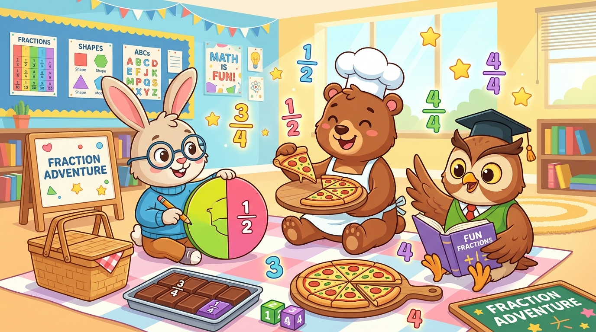

# 🍕 Pecahan Ceria - Media Pembelajaran Matematika Kelas 4 SD

Website media pembelajaran interaktif matematika materi **Pecahan untuk Kelas 4 SD** berbasis **Gamifikasi**, selaras dengan standar **Kurikulum Merdeka (Fase B Elemen Bilangan)**.

---

## 🌟 Fitur Utama

1. **🏠 Beranda & Gamifikasi HUD**:
   - Pemilihan Avatar & Nama Siswa (6 karakter maskot hewan lucu).
   - Indikator Level & Poin Pengalaman (XP).
   - 3 Hati Nyawa Petualang.
   - Papan Misi Harian & Koleksi Lencana Prestasi.
   - Efek suara interaktif berbasis Web Audio API (100% *offline*, tanpa aset eksternal).

2. **🎯 Capaian Pembelajaran (CP) & Tujuan Pembelajaran (TP)**:
   - Capaian Pembelajaran Fase B Elemen Bilangan.
   - 4 Tujuan Pembelajaran terinci (TP 1: Konsep Dasar, TP 2: Pecahan Senilai, TP 3: Membandingkan & Mengurutkan, TP 4: Operasi Penjumlahan & Pengurangan Berpenyebut Sama).
   - Indikator Ketercapaian TP (IKTP) dengan kotak centang mandiri interaktif.
   - Penguatan Dimensi Profil Pelajar Pancasila.

3. **🔬 Laboratorium Pecahan Visual Interaktif**:
   - **Pemotong Pizza SVG Arc**: Slider pembilang (1-12) dan penyebut (2-12) dinamis.
   - **Balok Cokelat Interaktif**: Grid potongan cokelat yang dapat diklik untuk memakannya.
   - **Dinding Pecahan Senilai (*Fraction Wall*)**: Sorot otomatis balok yang sejajar/setara.
   - **Timbangan Pecahan Ajaib (*Balance Scale*)**: Timbangan dinamis miring fisik sesuai nilai perbandingan (`>`, `<`, `=`).
   - **Lab Operasi Hitung**: Simulasi visual penggabungan dan pengurangan pecahan.

4. **🎮 Arena Game Edukasi**:
   - **Game 1: Dapur Chef Pizza**: Melayani pesanan pelanggan hewan, memilih loyang, dan menaburkan topping.
   - **Game 2: Tangkap Bintang Pecahan (Arcade Canvas)**: Menangkap pecahan bintang senilai menggunakan keranjang.

5. **🎬 Video Pembelajaran & Checkpoint**:
   - 4 video materi kurikulum merdeka.
   - Rangkuman materi kunci.
   - Kuis kilat *checkpoint* untuk klaim bonus +40 XP.
   - Buku catatan siswa yang otomatis tersimpan (*localStorage*).

6. **🏆 Kuis Petualang & Sertifikat Kelulusan**:
   - 10 soal tantangan variatif berstandar Kurikulum Merdeka.
   - Sistem nyawa dan pembahasan edukatif seketika.
   - Evaluasi persentase penguasaan tiap TP.
   - **Generator & Cetak Sertifikat Kelulusan**: Format cetak A4 *landscape* resmi dengan nama siswa, nilai, tanggal, dan segel medali emas.

---

## 🚀 Cara Menjalankan

Website ini menggunakan teknologi standar web modern murni (**HTML5, CSS3, dan Vanilla JavaScript**) tanpa dependensi npm:
1. Unduh / *clone* repositori ini.
2. Buka berkas `index.html` langsung di peramban Anda (Google Chrome, Microsoft Edge, Mozilla Firefox, dll.) atau klik dua kali `Buka_Website.bat` di Windows.
